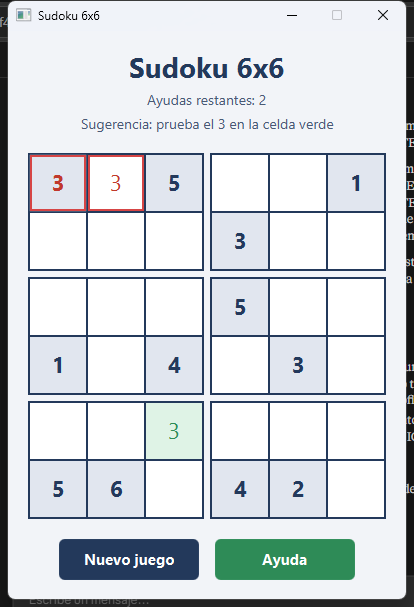

# Sudoku 6x6

Mini proyecto 2 del curso **750014C Fundamentos de Programación Orientada a Eventos**, Universidad del Valle.

Juego de Sudoku de 6x6 hecho en Java con JavaFX. El objetivo es llenar la cuadrícula con números del 1 al 6 sin repetir ninguno en cada fila, cada columna y cada bloque de 2x3.



## Integrantes

- Santiago Ruiz Vanegas
- Juan Manuel Cadena

## Cómo se juega

1. Presiona **Nuevo juego** y confirma. El tablero aparece con 2 números en cada bloque (en gris, no se pueden cambiar).
2. Haz clic en una celda vacía y escribe un número del **1 al 6**. Con **Backspace** o **Delete** lo borras.
3. Si un número se repite en su fila, columna o bloque, las celdas en conflicto se marcan con **borde rojo** y aparece un mensaje de error.
4. Si te atascas, presiona **Ayuda**: una celda vacía se pinta de verde con un número sugerido. Tienes **3 ayudas** por partida y la ayuda nunca llena la última celda.
5. Cuando el tablero está completo y sin errores, ganas.

## Cómo ejecutarlo

Requisitos: JDK 17 o superior y Maven (IntelliJ IDEA ya trae Maven).

- **IntelliJ IDEA:** abrir la carpeta del proyecto y ejecutar la clase `Launcher`.
- **Terminal:**

  ```bash
  mvn clean javafx:run
  ```

Para generar la documentación Javadoc en IntelliJ: **Tools → Generate JavaDoc...**, elegir la carpeta de salida `javadoc/` (está en el `.gitignore`) y en *Other command line arguments* poner `-encoding UTF-8`.

## Estructura (Modelo-Vista-Controlador)

```
src/main/java/com/example/sudoku/
├── Main.java, Launcher.java       Inicio de la aplicación
├── model/
│   ├── ISudokuBoard.java          Interfaz: contrato del tablero
│   ├── SudokuBoard.java           Tablero, generación, validación y ayuda
│   ├── IAlertBox.java             Interfaz de alertas
│   └── AlertBox.java              Alertas de confirmación, información y error
├── view/
│   └── GameStage.java             Ventana del juego (patrón Holder)
└── controller/
    ├── GameController.java        Eventos de la vista y comunicación con el modelo
    ├── ICellKeyListener.java      Interfaz de acciones de teclado sobre una celda
    └── CellKeyAdapter.java        Clase adaptadora de ICellKeyListener
src/main/resources/com/example/sudoku/
├── game-view.fxml                 Vista hecha en Scene Builder
└── styles.css                     Estilos de la interfaz
```

## Requisitos del enunciado

| Requisito | Dónde está |
|---|---|
| Interfaz gráfica con UX/UI | `game-view.fxml` y `styles.css`: paleta coherente, celdas fijas en gris, errores en rojo, ayuda en verde, mensajes para guiar al jugador |
| Interfaces y clases adaptadoras | `ISudokuBoard`, `IAlertBox`, `ICellKeyListener` y la clase adaptadora `CellKeyAdapter` |
| Eventos de mouse y teclado | `GameController.addCellEvents`: clic para seleccionar una celda y teclado para escribir o borrar números |
| Arquitectura MVC | Paquetes `model`, `view` y `controller` |
| Javadoc | Todas las clases y métodos están documentados |
| Layouts | `BorderPane`, `VBox`, `HBox` y `GridPane` (un `GridPane` por bloque dentro de otro `GridPane`) |
| Estructura de datos | `SudokuBoard` guarda el tablero y la solución en `ArrayList<ArrayList<Integer>>` |
| Git y GitHub | Ramas `SRV` y `JMC`, con Pull Requests hacia `main` |

## Cómo funciona el modelo

- **Generación del tablero (HU-2):** primero se llena una solución completa con *backtracking*. Se recorren las 36 celdas probando los números del 1 al 6 en orden aleatorio, y si ninguno sirve se retrocede a la celda anterior. Después se dejan visibles 2 números al azar en cada bloque de 2x3.
- **Validación (HU-4):** `canPlace` revisa que el número no esté en la misma fila, columna o bloque. El bloque de una celda empieza en la fila `(fila / 2) * 2` y la columna `(columna / 3) * 3`.
- **Ayuda (HU-5):** se elige una celda vacía al azar y se sugiere el número de la solución. Si ese número choca con lo que el jugador ya escribió, se busca otro número válido. La sugerencia no se escribe en el tablero.
